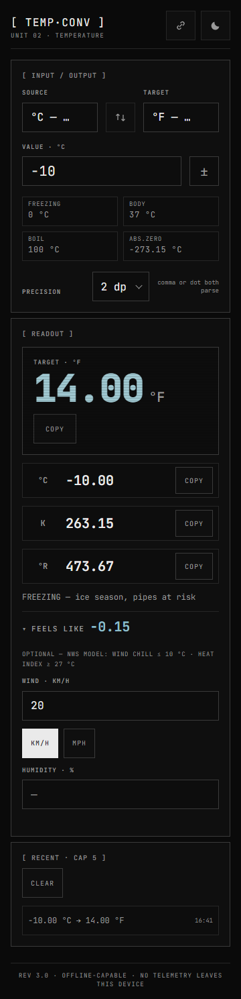

# TEMP·CONV

Temperature instrument — converts between **Celsius, Fahrenheit, Kelvin and Rankine**, reads the scale back as what it physically *feels like*, and works fully offline. Unit 02 of the [Tactical Telemetry](https://github.com/AkabaneKarmX) instrument set.


## Features

- **Four units, always live** — every keystroke converts to all three other scales at once; the target readout is the big hero, the other units are single-tap copy rows
- **Thermal colour readout** — the hero value shifts hue with the temperature: steel blue at −40 °C, neutral at room temperature, brick/alarm red from body heat to boiling
- **Feel band** — plain-language verdict under the readout ("FREEZING — ice season, pipes at risk", "HOT — shade and water")
- **Feels like (NWS models)** — optional panel that turns the temperature into a felt-temperature: **wind chill** at ≤ 10 °C with enough wind (min ~4.8 km/h / 3 mph), **heat index** at ≥ 27 °C with ≥ 40 % humidity; outside those windows it says what's missing instead of inventing a number. The felt value takes over the hero readout and its thermal colour while it applies, and wind units toggle KM/H ↔ MPH
- **Presets** — FREEZING / BODY / BOIL / ABS.ZERO, one tap each
- **Precision control** — 0 to 4 decimal places, noise-free display (0.1 + 0.2 never shows up as 0.30000000000000004)
- **Absolute-zero guard** — nothing below −273.15 °C parses as valid, in any input scale, float-edge included
- **Sign flip** — ± button negates the current value
- **Nudge from the keyboard** — ↑/↓ steps by 1 (Shift: 10, Alt: 0.1), Esc clears
- **Recent log** — last 5 conversions, capped, clearable
- **Shareable state** — the URL always carries the current conversion (`?v=36.6&from=C&to=F`), copy it to share
- **Offline PWA** — service worker, same-origin-only, installs to the home screen
- **Two themes** — dark phosphor console (default on dark OS) and light lab paper, auto or manual





## Privacy

No telemetry, no analytics, no network calls, no third-party requests. All state lives in `localStorage` on your device. See [SECURITY.md](SECURITY.md) for the full hardening notes (strict content-security policy, same-origin assets only, validated storage).

## How to run

Static site — no build step, no dependencies.

```bash
# serve over http (recommended so the offline service worker registers)
python -m http.server 8137
# then open http://127.0.0.1:8137/
```

Opening `index.html` directly from disk also works; only the offline install is skipped.

## Deploy (GitHub Pages)

1. Push this branch and merge, or serve `main`.
2. Settings → Pages → deploy from branch `main` → `/ (root)`.
3. After every change to any precached asset, bump `CACHE` in `sw.js` so returning visitors get fresh files. A pre-commit guard enforces this — it fingerprints every precached asset and blocks the commit if any of them changed while `CACHE` stayed the same.

## Enabling the cache guard

The guard runs on every commit, but hooks aren't cloned from GitHub — install it once after cloning:

```bash
cp tools/pre-commit .git/hooks/pre-commit
```

It is pure Node, reads assets straight from the git index (stable across line-ending settings), and refuses commits that alter precached files without a `CACHE` bump — including accidental bypasses it remembers after a `--no-verify` commit, which then block the next commit until you bump. Bypassing with `--no-verify` is allowed for WIP; the release commit must be guard-clean. To run the same check manually: `node tools/check-cache.js`.

## Tests

```bash
node --test tests/convert.test.js
```

28 tests covering the conversion core: all 16 unit pairs, the −40 °C = −40 °F identity, absolute-zero clamp in every scale, float-boundary at the floor, comma-as-decimal parsing, magnitude and length caps, precision formatting and `-0` cleanup, exact-offset **K↔R and F↔R paths** (300 K = 540.00 °R, 32 °F = 491.67 °R, no C-round-trip noise), plus the **NWS feels-like** models — wind-chill NWS reference values and validity windows, full Rothfusz heat-index at 27 °C+ with the low/high-RH adjustments, and a 16-pair noise sweep.

## Changelog

See [CHANGELOG.md](CHANGELOG.md).

## Project structure

```
index.html                instrument markup (strict CSP, no inline code)
Scripts/convert.js        pure conversion core (no DOM) incl. windChill/heatIndex/feelsLike
Scripts/app.js            UI wiring, URL/history state, offline registration
Stylesheets/app.css       design tokens (dark/light), layout, motion
tests/convert.test.js     node:test suite for the core (28 specs)
tools/check-cache.js      service-worker cache-drift guard
tools/pre-commit          git hook template wiring the guard in
.cache-manifest.json      guard's fingerprint of the last guard-clean commit
sw.js                     versioned cache-first service worker
manifest.webmanifest      install metadata + icons
assets/                   self-hosted JetBrains Mono, icons, screenshots
```
